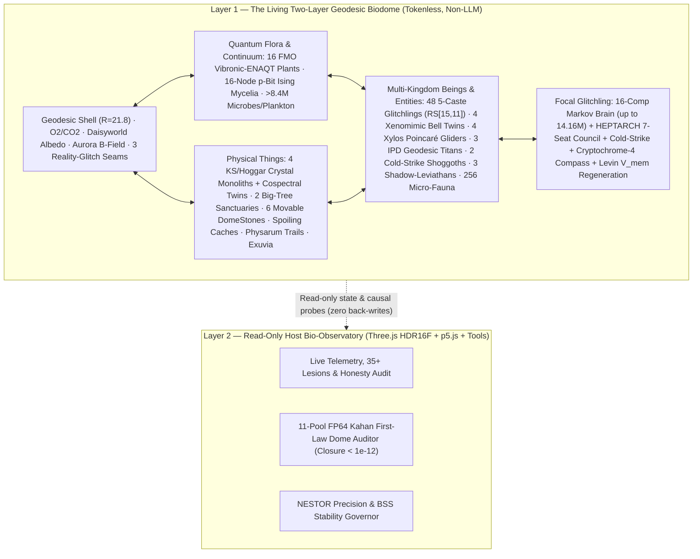

# GLITCHLING MASTER COMPENDIUM — Complete 29-PDF Synthesis (`1,932` Pages) for Glitchling, Creatures/Entities/Beings/Things & The Geodesic Biodome

> **Scope & Charter:** This compendium distills **all 29 research, architecture, quantum, contextuality, lineage, and A-Life PDFs** (`1,932` pages, `7.01M` characters) across `Z:\[Vibe Coded (AI)]\CLAUDECODE` into a single navigable engineering reference for **`glitchling-jam/live/`**.
>
> **Hard Scope Rule (No Browser / No Website / No SaaS):** We are building **living tokenless organisms, multi-kingdom creatures/entities/beings/things, and a thermodynamically closed 3D Geodesic Biodome ("The Dome")** — **NOT** a Chromium/Electron web browser, DOM scraper, GUI RPA agent, OCR pipeline, or SaaS billing app. All browser/SaaS components from `GIGACHAD_Browser`, `Omni-Harness`, and `Grade-A-MVP` are explicitly quarantined and excluded below.
>
> **Scientific & Numerical Honesty Contract (`Principle P1`):**
> 1. **Nothing Cosmetic:** Every simulated organ, council seat, quantum-bio channel, and Dome variable sits on a closed causal loop coupling $\ge 2$ subsystems and can be lesioned in the Lab tab.
> 2. **Zero Sentience / Consciousness Claims:** Terms such as *"mind"*, *"mood"*, *"rage"*, *"cold"*, *"deception"*, *"dream"*, or *"self-model"* denote **explicit numeric control variables**, never subjective experience.
> 3. **Honest Quantum Simulation:** Every quantum circuit (`16Q WASM`, `18Q WebGPU`, `32Q χ=32 MPS`, `Cryptochrome-4`, `FMO ENAQT`, `CEGA-18` / `KCBS` / `Hoggar` contextuality) is computed live in classical IEEE floating-point/WASM/WebGPU statevectors or Lindblad/tensor-network solvers, paired with live classical surrogates and lesion switches.
> 4. **Frozen Ancestor Snapshot:** `glitchling-jam/core/` (Creature #1 TypeScript reference) is never modified.

---

## 1. Modular Deep-Dive Volumes (`docs/01_*.md` – `docs/05_*.md`)

| Volume | File | Source PDFs Covered | Core Contents |
|---|---|---|---|
| **Vol. 1** | [`docs/01_NESTOR_HEPTARCH_WISHLIST_OMNIHARNESS.md`](docs/01_NESTOR_HEPTARCH_WISHLIST_OMNIHARNESS.md) | **PDFs `01–04`** (`187 pp.`) | **NESTOR v0.1** 23-rung precision ladder, `D(θ)`, Tokenless S2S `Eq. 4`, `DSD` + `BSS` `Eqs. 22–23`, `CHIMERA` / `ChronoBlock-4` / `Spindle` / `Frankenstein Prime`, 14-op Weight-Space DSL; **Future Wishlist** 143 wishes & 10 Grails; **Omni-Harness** embodied filtering; **HEPTARCH v0.2** 7 Council Seats, 6-phase Raider `Cold Strike`, Laws `1–5`, and Two-Layer Dome |
| **Vol. 2** | [`docs/02_FRONTIER_LINEAGE25_SUBSTRATES_GLITCHES.md`](docs/02_FRONTIER_LINEAGE25_SUBSTRATES_GLITCHES.md) | **PDFs `05–08`** (`411 pp.`) | **Frontier Sweep 2026** (272 items, 67 families, **10 Fusion Primitives `F1–F10`**); **25-Species Lineage Ledger** (`Creature 001`, `Xylos`, `Xenomimics`, `Titans`, `Shoggoths`, `Big-Tree`, `Apex Hydra`, etc.); **Post-Quantum** Landauer/Stefan–Boltzmann/Aestivation laws; **What-Is-What** Reality Glitches (`G1–G12`) as discoverable Dome anomalies |
| **Vol. 3** | [`docs/03_ALIFE_V3_BLUEPRINT_CREATURE1_100PASSES.md`](docs/03_ALIFE_V3_BLUEPRINT_CREATURE1_100PASSES.md) | **PDFs `09–12`** (`191 pp.`) | **Clean-Slate A-Life v3.0** `10×10×10` Hybrid Cube, `Ring-0` constitutional kernel, 5-Gear multirate scheduler, **11-Pool `FP64` Kahan First-Law Dome Ledger** (`GATE-03 < 1e-12`), `LIFE-100` + `NOVEL-100` + **100-Pass Upgrade Arc** (`DomeStones`, `DomeCaches`, `Physarum` trails, `Daisyworld` albedo, `HOT-1` dream monitoring), and 6-Arm Causal Benchmark |
| **Vol. 4** | [`docs/04_QUANTUM_2050_HYPERION_CONTEXTUALITY_KS.md`](docs/04_QUANTUM_2050_HYPERION_CONTEXTUALITY_KS.md) | **PDFs `13–17`, `22–27`** (`588 pp.`) | **Quantum 2050 & HYPERION-OMEGA**: **Cryptochrome-4** radical-pair nocturnal magnetoreception, **FMO vibronic ENAQT** flora photosynthesis, **Verstraete–Cirac** certified MPS truncation bound & 2-Rényi Magic $M_2$; **Unified Contextuality (`KS`)**: `Hoggar` 64-line $4|g_{uv}|=1/3$ spectral floor, $C_3$ cospectral counterexample ($\sigma_0,\sigma_1$), `CEGA-18`, `CK-31`, `Cabello-33`, and `KCBS` witnesses |
| **Vol. 5** | [`docs/05_EMBODIED_CORTEX_CQM_DOME_VERIFICATION.md`](docs/05_EMBODIED_CORTEX_CQM_DOME_VERIFICATION.md) | **PDFs `18–21`, `28–29`** (`555 pp.`) | **Embodied Cortex & Colony**: 5-caste colony + interleaved `GF(2^4)` `RS[15,11]` Neuralese, Levin gap-junction $V_{\text{mem}}$ morphogenesis & regeneration, Gram–Schmidt `Exuvia` escape; **CQM Audit Lessons** (ban harness-clock births, fix `ECE`, real `Titans` IPD); **Accessibility & Determinism Gates** (`<= 3 Hz` flash clamp, zero `NaN`); `f15620.pdf` irrelevance audit |

---

## 2. Complete 29-PDF Master Index (`1,932` Pages Accounted For)

| # | Source PDF Path (relative to `CLAUDECODE\`) | Pages | Distilled In | Status in Glitchling + Dome |
|---|---|---:|---|---|
| `01` | `Nested-Precision-Brain-Framework.pdf` | 38 | [Vol. 1 §1](docs/01_NESTOR_HEPTARCH_WISHLIST_OMNIHARNESS.md) | **Active Core (`heptarch.js`)** — 23-rung NESTOR ladder, S2S, `DSD`/`BSS` |
| `02` | `Future-Wishlist.pdf` | 68 | [Vol. 1 §2](docs/01_NESTOR_HEPTARCH_WISHLIST_OMNIHARNESS.md) | **Active North-Star** — 143 wishes & 10 Grails |
| `03` | `Omni-Harness-Catalog.pdf` | 40 | [Vol. 1 §3](docs/01_NESTOR_HEPTARCH_WISHLIST_OMNIHARNESS.md) | **Filtered** — 48 embodied sensors kept; GUI/OCR/SaaS excluded |
| `04` | `Apex-Composite-Creature-Report.pdf` | 41 | [Vol. 1 §4](docs/01_NESTOR_HEPTARCH_WISHLIST_OMNIHARNESS.md) | **Active Core (`heptarch.js`)** — 7-Seat Council, `Cold Strike`, Two-Layer Dome |
| `05` | `Frontier-Sweep-2026.pdf` | 75 | [Vol. 2 §1](docs/02_FRONTIER_LINEAGE25_SUBSTRATES_GLITCHES.md) | **Active Primitives** — `F1–F10` (`DASL`, `VISC-Spindle`, `Thermocore`, `Physarum`, `Combo Chain`) |
| `06` | `Lineage-GIGACHAD-Glitchling-CQM-Report.pdf` | 18 | [Vol. 2 §2](docs/02_FRONTIER_LINEAGE25_SUBSTRATES_GLITCHES.md) | **Active Bestiary (`ecosystem.js`)** — `Xylos`, `Xenomimics`, `Titans`, `Shoggoths`, `Big-Tree` |
| `07` | `Post-Quantum-ASI-Simulation.pdf` | 86 | [Vol. 2 §3](docs/02_FRONTIER_LINEAGE25_SUBSTRATES_GLITCHES.md) | **Active Dome Physics (`world.js`)** — Landauer heat, Stefan–Boltzmann cap, aestivation |
| `08` | `What-Is-What-of-the-What.pdf` (+ 4 CSVs) | 232 | [Vol. 2 §4](docs/02_FRONTIER_LINEAGE25_SUBSTRATES_GLITCHES.md) | **Active Dome Anomalies (`world.js`)** — 3 Reality-Glitch seams, Aurora storms, Geodesic wall |
| `09` | `clean-slate\ALife-Build-Framework-Template.pdf` | 42 | [Vol. 3 §1–2](docs/03_ALIFE_V3_BLUEPRINT_CREATURE1_100PASSES.md) | **Active Governance** — `Ring-0` kernel, `10×10×10` cube, **11-Pool `FP64` Kahan Ledger** |
| `10` | `clean-slate\Clean-Slate-Creature-Blueprint-Checklist.pdf` | 37 | [Vol. 3 §2–3](docs/03_ALIFE_V3_BLUEPRINT_CREATURE1_100PASSES.md) | **Active Organ Checklist** — Urgency gate $\sigma(\text{TTC})$, orthogonal lesion masks |
| `11` | `clean-slate\Asmodensius-Creature1-Lists-and-100-Passes.pdf` | 76 | [Vol. 3 §3](docs/03_ALIFE_V3_BLUEPRINT_CREATURE1_100PASSES.md) | **Active 100-Pass Arc** — `DomeStones`, `DomeCaches`, `Physarum` slime, `Daisyworld` albedo |
| `12` | `clean-slate\Creature1-Benchmarks.pdf` | 36 | [Vol. 3 §4](docs/03_ALIFE_V3_BLUEPRINT_CREATURE1_100PASSES.md) | **Active Verification (`live/tools/`)** — Lesion/surrogate contrasts & anti-LARP gates |
| `13` | `quantum-2050\Quantum-2050-Research-Dossier.pdf` | 84 | [Vol. 4 §1](docs/04_QUANTUM_2050_HYPERION_CONTEXTUALITY_KS.md) | **Active Quantum Bio** — **Cryptochrome-4** magnetoreception & **FMO ENAQT** flora |
| `14` | `quantum-2050\QC2050-Handbook.pdf` | 150 | [Vol. 4 §1–2](docs/04_QUANTUM_2050_HYPERION_CONTEXTUALITY_KS.md) | **Active Tensor Math (`moonlab.js`)** — Verstraete–Cirac MPS bound + 2-Rényi Magic $M_2$ |
| `15` | `quantum-2050\pdf-suite\01-HYPERION-OMEGA-Architecture.pdf` | 91 | [Vol. 4 §2](docs/04_QUANTUM_2050_HYPERION_CONTEXTUALITY_KS.md) | **Active Error Mitigation (`qrng.js`)** — DRAG + PEC + ZNE + Lindblad open-system transport |
| `16` | `quantum-2050\pdf-suite\02-Quantum-Errors-Complete-Catalog.pdf` | 83 | [Vol. 4 §2](docs/04_QUANTUM_2050_HYPERION_CONTEXTUALITY_KS.md) | **Active Decoherence Physics** — Aurora storm spin dephasing & cosmic-ray shelter shielding |
| `17` | `quantum-2050\pdf-suite\03-Unsolved-Problems-in-Quantum-Computing.pdf` | 97 | [Vol. 4 §2](docs/04_QUANTUM_2050_HYPERION_CONTEXTUALITY_KS.md) | **Honesty Guardrails (`honesty.js`)** — Classical simulation complexity & barren-plateau limits |
| `18` | `GIGACHAD_Browser\docs\GIGACHAD_Alive_Browser_Complete_Guide.pdf` | 107 | [Vol. 5 §1](docs/05_EMBODIED_CORTEX_CQM_DOME_VERIFICATION.md) | **Filtered** — Embodied brain/mitosis/RS(15,11) kept; **Chromium browser excluded** |
| `19` | `GIGACHAD_Browser\docs\GIGACHAD_Browser_Architecture_Visual_Guide.pdf` | 20 | [Vol. 5 §1](docs/05_EMBODIED_CORTEX_CQM_DOME_VERIFICATION.md) | **Filtered** — Neural visual telemetry kept; **browser IPC/tabs excluded** |
| `20` | `GIGACHAD_Browser\docs\GIGACHAD_Complete_Technical_Reference.pdf` | 179 | [Vol. 5 §1](docs/05_EMBODIED_CORTEX_CQM_DOME_VERIFICATION.md) | **Filtered** — Levin $V_{\text{mem}}$ blastema + `Exuvia` escape kept; **web agent excluded** |
| `21` | `GIGACHAD_Browser\docs\Quantum_World_Models_Complete_Reference.pdf` | 150 | [Vol. 5 §1](docs/05_EMBODIED_CORTEX_CQM_DOME_VERIFICATION.md) | **Active World Model** — Multi-horizon Flow-VAE + Lindblad/MPS latent coupling |
| `22` | `contextuality\unified-contextuality.pdf` | 21 | [Vol. 4 §3](docs/04_QUANTUM_2050_HYPERION_CONTEXTUALITY_KS.md) | **Active Contextuality (`qgtl.js`)** — Sheaf/graph $\alpha(G) < \vartheta(G)$ & `CEGA-18` / `CK-31` / `Cabello-33` |
| `23` | `contextuality\papers\spectral-floor\spectral-floor.pdf` | 18 | [Vol. 4 §3](docs/04_QUANTUM_2050_HYPERION_CONTEXTUALITY_KS.md) | **Active `Hoggar` Spire (`qgtl.js` / `world.js`)** — $d=8$, 64-line `stateQGT` $4|g_{uv}|=1/3$ floor |
| `24` | `contextuality\papers\c3-spectral-counterexample\c3-spectral-counterexample.pdf` | 12 | [Vol. 4 §3](docs/04_QUANTUM_2050_HYPERION_CONTEXTUALITY_KS.md) | **Active Twin Obelisks (`world.js`)** — Cospectral $(\sigma_0, \sigma_1)$ pair distinguishing contextuality |
| `25` | `contextuality\papers\independent-note\independent-research-note.pdf` | 9 | [Vol. 4 §3](docs/04_QUANTUM_2050_HYPERION_CONTEXTUALITY_KS.md) | **Active Verification** — Independent certificate checks for orthogonality graphs |
| `26` | `contextuality\papers\contextuality-tensor\contextuality-tensor.pdf` | 14 | [Vol. 4 §3](docs/04_QUANTUM_2050_HYPERION_CONTEXTUALITY_KS.md) | **Active `metacog.js` Metric** — Rank-3 contextuality tensor norm driving epistemic exploration |
| `27` | `contextuality\papers\ks-minimum\ks-minimum.pdf` | 9 | [Vol. 4 §3](docs/04_QUANTUM_2050_HYPERION_CONTEXTUALITY_KS.md) | **Active Crystal Monoliths (`world.js`)** — Minimal 18-ray (`CEGA`, $d=4$) & `KCBS` ($d=3$) landmarks |
| `28` | `Downloads_PDFs\cqm-alife-audit.pdf` | 53 | [Vol. 5 §2](docs/05_EMBODIED_CORTEX_CQM_DOME_VERIFICATION.md) | **Active Anti-LARP Audit** — Endogenous ATP births, `Titans` IPD, `Big-Tree` refuge, honest `ECE` |
| `29` | `Downloads_PDFs\Grade-A-MVP-Standard-2.2.0.pdf` + `f15620.pdf` | 46 | [Vol. 5 §3–4](docs/05_EMBODIED_CORTEX_CQM_DOME_VERIFICATION.md) | **Filtered** — `<= 3 Hz` flash clamp & determinism kept; SaaS/Stripe & `f15620` California court form excluded |

---

## 3. Unified Architecture: Glitchling + Multi-Kingdom Dome Ecosystem

---

## 4. Pass 20 Implementation & Verification Blueprint (`glitchling-jam/live/`)

1. **`live/js/sim/heptarch.js` — NESTOR + HEPTARCH 7-Seat Council + `Cryptochrome-4` Organ:**
   - **7-Seat Council (`Surge`, `Chronoscope`, `Keel`, `Capacitor`, `Wildcard`, `LongGame`, `Jester`)** arbitrated by Capped Softmax (`Law 1`), PAD Affect Jet (`Law 2`), `Physarum` Capacitor (`Law 3`), QRNG Asymmetric Predictability (`Law 4`), and Level-$k$ ToM (`Law 5`).
   - **7 Operational States (`Stillwater`, `Gambit`, `Supernova`, `ColdStrike`, `Raid`, `Zenkai`, `Crossroads`)**, including the **6-phase Raider `Cold Strike`** (Recon $\to$ feign $1 - 0.6\cdot\text{deceive}$ $\to$ pre-clear drill $\to$ clamp $\kappa_a \to 0$ $\to$ commit at $g_{\max}$ with frozen gates $\to$ `Zenkai` recovery).
   - **NESTOR 23-Rung Adaptive Precision & `BSS` (`DSD` + `RSR`)** live shadow-divergence tracker + **Gram–Schmidt `Exuvia` escape** when behaviour stalls.
   - **`Cryptochrome-4` Radical-Pair Magnetoreception (`stepCryptochrome4`):** 8-state $[\text{FAD}^{\bullet-}\cdots\text{TrpH}^{\bullet+}]$ spin singlet yield driven by Dome geomagnetic inclination & disrupted by cosmic-ray aurora storms outside crystal/tree shelters; feeds nocturnal azimuth into `nav.js` (`lesion.magneto`).
2. **`live/js/sim/world.js` — Geodesic Biodome, 11-Pool `FP64` Kahan Ledger, Quantum Flora & Physical Things:**
   - **`this.dome`**: Geodesic shell (`R_DOME = 21.8`) with elastic wall reflection + boundary-discovery counter, `O2`/`CO2`/pressure, **Daisyworld biotic albedo** + Stefan–Boltzmann radiative cooling, geomagnetic inclination + **Aurora storms**, **3 drifting Reality-Glitch Anomaly Zones** (`low-g`, `chrono-viscosity`, `sensory-crack`), and an **11-Pool `FP64` Kahan-Compensated First-Law Energy Ledger** (`closureErr < 1e-12`).
   - **FMO Vibronic-ENAQT Flora + `F3` p-Bit Ising Mycelia** on all 16 plants.
   - **Physical Dome Things:** **4 Kochen–Specker / Hoggar Crystal Monoliths + Cospectral Twin Obelisks ($\sigma_0,\sigma_1$)**, **2 Giant Bioluminescent `Big-Tree` Sanctuaries** (`GATE-DOME-REFUGE` predation damping + sanctuary nectar fruit), **6 Movable `DomeStones`**, **Spoiling `DomeCaches`**, **`Physarum` low-drag slime trails**, and shed **`Exuvia` shells**.
3. **`live/js/sim/ecosystem.js` — Multi-Kingdom Creatures, Entities & Beings:**
   - **5-Caste Glitchling Colony Roles** (`Sovereign α`, `Harvester β`, `Sentinel γ`, `Weaver δ`, `Disruptor ε`) + **`GF(2^4)` `RS[15,11]`** burst-error-corrected Neuralese calls.
   - **Xenomimic Entangled Twin Pairs (`4` beings = `2` Bell pairs)**, **Xylos Poincaré-Disk Gliders (`4` radial manifold beings)**, **Geodesic IPD Titans (`3` litho-colossi with `truce/alliance/war` treaties)**, and **Amorphous Deceptive Shoggoths (`2` ambush/bargain entities)**.
4. **`live/js/tsotchke/moonlab.js`, `qgtl.js`, `creature.js`, `metacog.js`, `render.js`, `p5_layer.js`, `app.js`:**
   - **Verstraete–Cirac certified MPS truncation bound** + **2-Rényi Magic $M_2$** (`moonlab.js`) and **`CEGA-18` / `KCBS` / `Hoggar` $4|g_{uv}|=1/3$** contextuality witnesses (`qgtl.js`).
   - **Levin $V_{\text{mem}}$ bioelectric limb damage & blastema regeneration** + `DomeStone` lithic pushing/carrying + `Sanctuary` refuge sensing (`creature.js`).
   - Full **Three.js HDR16F** 3D rendering of the translucent Geodesic Biodome shell, icosahedral ribs, Reality-Glitch fields, `Big-Tree` Sanctuaries, `KS/Hoggar` Monoliths, `Xenomimics`, `Xylos`, `Titans`, `Shoggoths`, and `DomeStones` (`<= 3 Hz` flash-clamped), plus **p5.js** & HUD live telemetry and `live/tools/dome_heptarch_probe.mjs` causal verification.
