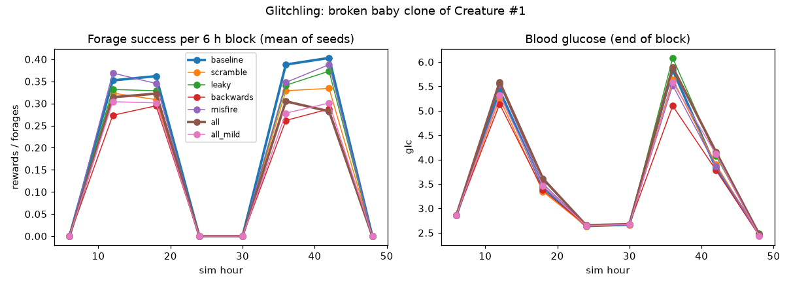

# Glitchling (`v2.3.0`)

[](https://github.com/0thernes/glitchling-jam/actions/workflows/ci.yml)
[](https://0thernes.github.io/glitchling-jam/)
[](lean/README.md)
[](#real-vs-simulated-please-read)

A deliberately broken baby clone of Alexander Stephen Donahue's A-Life **Creature #1**, built in a one-day jam (Nov 1, 2026) and hardened into a cross-platform reproducible artificial-life research suite, with a Lean 4 model of its core discrete invariants. **Status:** `active` (`v2.3.0`).

It has four engineered flaws you can switch on and off:

- **scramble**: senses read through a random permutation plus noise, re-shuffled every 90 ticks
- **leaky**: learned values decay toward their prior by 6% per tick
- **backwards**: the 8 MOT motor neurons read out reversed, and the chosen site is mirrored ($k \mapsto 15 - k$)
- **misfire**: every 60 ticks, one site value and 20 random synapses get a jolt



## Live Interactive Pages

- **Landing page:** https://0thernes.github.io/glitchling-jam/
- **Glitchling v2 (live 3D soft-body & spiking brain biodome):** https://0thernes.github.io/glitchling-jam/live/
- **Play the 2D sim:** https://0thernes.github.io/glitchling-jam/play/
- **Jam showcase:** https://0thernes.github.io/glitchling-jam/site/
- **Brain viz (real activation playback):** https://0thernes.github.io/glitchling-jam/brain-viz/

## Quickstart

Zero external runtime npm packages and zero build step are required. Clone and verify everything locally:

```bash
git clone https://github.com/0thernes/glitchling-jam.git
cd glitchling-jam

# 1. Core health check (syntax, JSON, links, secrets, honesty guard, determinism, Bun ref-sim)
npm test

# 2. JS Verification Ladder (1,200 property checks, 7 negative, 7 regressions, 4 metamorphic, 8/8 mutants killed)
npm run verify:ladder

# 3. Runnable examples & Results v3 paired statistics
npm run examples
npm run stats

# 4. Independent Python Kronecker/Fraction reference oracle & Hypothesis tests
python scripts/verify_exact.py
python -m pytest tests/test_oracle.py -v

# 5. Pure zero-Mathlib Lean 4.35.0 formal core (72 audited declarations + leanchecker)
cd lean && lake build GlitchlingProofs Challenge Solution && lake env lean VerifyAxioms.lean
```

## Usage

### Run the repeatable TypeScript reference sim (`Results v3`)

```bash
BUN_JSC_useConcurrentJIT=0 bun run glitchling.ts 2 30 500   # days=2, 30 seeds 500-529 -> results/summary.csv
node tools/results_stats.mjs                                # paired t-intervals, Cohen's d_z, 200k permutation p
python3 plot.py                                             # -> results/glitchling.png, results/cursed_portrait.png
```

### Run warmed benchmarks, lesion experiments, or local static server

```bash
npm run bench                                                              # -> results/perf-benchmarks.json
npm run serve                                                              # -> http://127.0.0.1:8000/
FROM_T=5 TO_T=5 SEEDS=1,2,3,4,5,6,7,8,9,10,11,12 node live/test/lesion_experiments.mjs
```

Browser URL settings work out of the box, e.g. `play/?seed=7&flaws=backwards,scramble` or `live/?seed=7&brain=M`. See [`examples/`](examples/) and [`docs/configuration.md`](docs/configuration.md) for full options.

## Research Manuscript, Claims & Mega-Atlas Cross-Check

- **AMS-LaTeX White Paper (Preprint, not peer-reviewed):** [`paper/main.tex`](paper/main.tex) · [`paper/WHITE_PAPER.md`](paper/WHITE_PAPER.md) · [`dist/Donahue_2026_glitchling_alife_verification.pdf`](dist/Donahue_2026_glitchling_alife_verification.pdf) · [`dist/arxiv_submission.tar.gz`](dist/arxiv_submission.tar.gz)
- **Claims & Falsification Ledger (`C1–C10`):** [`CLAIMS.md`](CLAIMS.md) · [`VERIFICATION.md`](VERIFICATION.md) · [`docs/statement-fidelity.md`](docs/statement-fidelity.md)
- **Unsolved Problems Mega-Atlas Cross-Check (1,900 problems):** [`docs/MEGA_ATLAS_CROSSCHECK.md`](docs/MEGA_ATLAS_CROSSCHECK.md) — **honest verdict: `0 / 1,900` open problems solved** (scoped toy-model overlaps documented explicitly).
- **Hardening Audits & Errata:** [`AUDIT/`](AUDIT/) (35 passes, `F01–F33`) · [`docs/reviews/2026-11-25-3cycle-hardening-audit.md`](docs/reviews/2026-11-25-3cycle-hardening-audit.md) (`F24/F30/F33–F40`) · [`ERRATA.md`](ERRATA.md) · [`LIMITATIONS.md`](LIMITATIONS.md) · [`REPLICATION.md`](REPLICATION.md)

## Pure Lean 4.35.0 Formal Core & Verbatim `#print axioms` Audit

All 72 exported declarations (`63` library theorems across `EnergyMassConservation`, `QuantumContextuality`, `CodingAndGovernance`, `HyperbolicAndFlaws`, `NonVacuity` [6 witnesses], and `AdversarialTests` [6 false-variant refutations] + `9` isolated comparator targets in `Solution.lean` matched against `Challenge.lean`) compile with **zero Mathlib**, **zero `sorry`** (the only `sorry` placeholders are the intentional targets in `Challenge.lean`), **zero `native_decide`** and `autoImplicit = false`, and depend only on `[propext, Classical.choice, Quot.sound]` (or zero axioms). They are kernel-checked by Lean (`lake build`, `lake env leanchecker --fresh`); the 9 comparator targets in `comparator.json` (and their dependency closure) were also accepted by 6 independent kernels (`Lean paranoid`, `lean4lean`, `nanoda`, `con-leche`, `con-ron`, `Lean default`) via `lake comparator --config comparator.json --paranoid`, and CI checks that a `sorry`-tampered `Solution.lean` is rejected (`scripts/test_lean_negative.py`). Full 72-declaration output is saved in [`results/lean_axioms.txt`](results/lean_axioms.txt) and guarded against drift by `scripts/check_readme_axioms.py`:

<!-- LEAN_AXIOMS_START -->
```text
'Glitchling.runEnergyOps_preserves_firstLaw' depends on axioms: [propext, Quot.sound]
'Glitchling.fluxSoil_preserves_mass' depends on axioms: [propext, Quot.sound]
'Glitchling.clausius_entropy_nonneg' depends on axioms: [propext, Quot.sound]
'Glitchling.cega18_rays_nonzero' does not depend on any axioms
'Glitchling.cega18_kochen_specker_uncolorable' depends on axioms: [propext, Quot.sound]
'Glitchling.cega18_classical_max_eight' depends on axioms: [propext, Quot.sound]
'Glitchling.chsh_game_classical_max_three' does not depend on any axioms
'Glitchling.gf16_exists_inv' depends on axioms: [propext, Quot.sound]
'Glitchling.heptarch_anti_duopoly' depends on axioms: [propext, Quot.sound]
'Glitchling.heptarch_all_modes_feasible' does not depend on any axioms
'Glitchling.nestor_sr_unbiased' depends on axioms: [propext, Quot.sound]
'Glitchling.nestor_sr_variance_bound' depends on axioms: [propext, Quot.sound]
'Glitchling.poincare_mobius_norm_identity' depends on axioms: [propext, Quot.sound]
'Glitchling.poincare_mobius_preserves_disk' depends on axioms: [propext, Quot.sound]
'Glitchling.nv02_clausius_strict_pos_witness' does not depend on any axioms
'Glitchling.nv06_poincare_interior_witness' does not depend on any axioms
'Glitchling.at01_refute_unlogged_energy_creation' depends on axioms: [propext, Quot.sound]
'Glitchling.at02_refute_cega18_noncontextual_nine' depends on axioms: [propext, Quot.sound]
'Glitchling.at05_refute_poincare_boundary_escape' depends on axioms: [propext, Quot.sound]
'Glitchling.ComparatorTarget.target_thm1_energy_mass_clausius' depends on axioms: [propext, Quot.sound]
'Glitchling.ComparatorTarget.target_thm2_cega18_kochen_specker' depends on axioms: [propext, Classical.choice, Quot.sound]
'Glitchling.ComparatorTarget.target_thm3_chsh_and_nosignaling' depends on axioms: [propext, Classical.choice, Quot.sound]
'Glitchling.ComparatorTarget.target_thm4_gf16_and_rs15_11' depends on axioms: [propext, Quot.sound]
'Glitchling.ComparatorTarget.target_thm5_heptarch_anti_monarchy' depends on axioms: [propext, Quot.sound]
'Glitchling.ComparatorTarget.target_thm6_nestor_stochastic_rounding' depends on axioms: [propext, Quot.sound]
'Glitchling.ComparatorTarget.target_thm7_poincare_mobius_containment' depends on axioms: [propext, Quot.sound]
'Glitchling.ComparatorTarget.target_thm8_flaws_and_nonvacuity' depends on axioms: [propext, Classical.choice, Quot.sound]
'Glitchling.ComparatorTarget.target_thm9_adversarial_and_nonvacuity' depends on axioms: [propext, Classical.choice, Quot.sound]
```
<!-- LEAN_AXIOMS_END -->

**Scope of the Lean results (statement audit, 2026-11-26).** The theorems concern a hand-written Lean transcription of the simulator's discrete rules (`lean/GlitchlingProofs/Spec.lean`), not the JavaScript/TypeScript code itself; agreement with the JS is tested differentially and by property tests, not proven. Several items are weaker than their names suggest:

- `rs15_11_mds_radius` checks only the Singleton arithmetic `d = 15 - 11 + 1 = 5`, `t = 2`. No Reed–Solomon code, minimum distance or decoder is modelled in Lean; decoding is covered by property tests only.
- `c3_cubic_trace_gap` checks only `15360 - 14976 = 384` on literals. The traces themselves are an exact-rational Python result.
- `bell_diagonal_exact_no_signaling` is a definitional consistency check of hand-written marginal formulas; no density matrix or partial trace is modelled.
- The Clausius result shows that the model's numerator is `>= 0` when `0 < T_sky <= T_amb <= T_geo` and the fluxes `qDiss, qGeo, qRad >= 0`; it is not a derivation of the Second Law.
- The NESTOR results are polynomial identities for two-point rounding (expectation and variance numerators) with no probability model; Möbius containment is proved for rational (integer-scaled) points of the open unit disk.
- The energy ledger is proved balanced under every finite operation sequence; the N/C mass ledger has single-step preservation lemmas only.

CEGA-18 uncolourability is a known result of Cabello, Estebaranz and García-Alcaine (1996), and the CHSH bound for deterministic local outcomes is due to Clauser, Horne, Shimony and Holt (1969); this repository formalizes them for its own model. Audit log: <https://github.com/0thernes/0thernes-research-archive/blob/main/docs/reviews/2026-11-26-statement-audit.md>. Corrections are listed in [`ERRATA.md`](ERRATA.md).

## Real vs simulated (please read)

- **`play/` is a simplified JavaScript port** written for exploring the flaws interactively. It is **not** the TypeScript reference run, and its numbers will not match the published results.
  - *Kept from the reference:* 16 sites (4 colours × 4 shapes) with the same reward formula, depletion and the days 1–3 half-access pattern; 1 tick = 1 sim-minute; the 272-neuron layout in the same 14 regions with the reference's region-to-region connection probabilities; the four flaws applied the way `glitchling.ts` applies them; seeded mulberry32 RNG with a separate flaw stream.
  - *Simplified or invented:* rate-unit neurons instead of the spiking substrate; a 3-pool toy metabolism; a noisy value race instead of the striatal spike race and expected-free-energy terms; the walking body, 2D map and click-to-drop food; MOT as an 8-way heading code. Since 2026-11-24 the world shuffle uses a seeded Fisher–Yates, so every browser builds the same world for a seed.
- **The results tables, plots and brain-viz playback come from the TypeScript sim** (`glitchling.ts` subclassing `core/organism.ts`, a frozen copy of the Creature #1 organism). Results v3 (2026-11-24) uses 30 dev seeds per condition (500–529) and reports means, SDs, 95% CIs and paired effect sizes. With all flaws on: forages +22% (`Δ +45.8 [34.5, 57.1]`, $d_z = 1.51$), success `0.299` vs `0.365` (`Δ -0.066`), rewards about the same (`76.3` vs `74.5`), `210/210` runs alive. The v2 hint of within-life hit-rate compensation did **not** replicate (`-0.016 [-0.042, +0.009]`) and was withdrawn.
- **Repeatability (audit F31):** Under default Bun/JavaScriptCore settings, `glitchling.ts` depends on concurrent JIT timing. Results v3 was generated with `BUN_JSC_useConcurrentJIT=0` (two simultaneous runs were byte-identical).
- **Quantum modules & synapse scales (`F01`):** Every quantum module (`FMO`, `Cry4`, `CHSH`, `CEGA-18`, `Hoggar`, `C3`) executes classical linear algebra on CPU (with optional WASM/WebGPU) and proves mathematical correctness, not physical quantum effects. `MEGA` (`16.78M`) and `GIGA` (`1.13B`) synapse totals are **nominal** formulas (`30,554` and `28,131` explicitly stored + `113M` Int8 cluster weights on `GIGA`).
- Some showcase renders (`v4`) are driven by **synthetic** data and labelled `SYNTHETIC` on every frame.
- **No claims of consciousness, sentience, feelings, or AGI are made for Glitchling or Creature #1.** See [`LIMITATIONS.md`](LIMITATIONS.md).

## Layout

| Path | What |
|---|---|
| [`lean/`](lean/) | Pure Lean `v4.35.0` formal core (0 Mathlib, 72 audited declarations, `Challenge`/`Solution` comparator targets checked by 6 kernels, `NonVacuity` & `AdversarialTests`) |
| [`reference/`](reference/), [`tests/`](tests/) | Independent Python Kronecker/Fraction reference oracle (`glitchling_oracle.py`) + `pytest`/`hypothesis` suite |
| [`paper/`](paper/), [`dist/`](dist/) | AMS-LaTeX scientific preprint (`main.tex`, `refs.bib`, `WHITE_PAPER.md`), vector figures, frozen PDF & arXiv tarball |
| [`live/`](live/) | Glitchling v2 live 3D A-Life Bio-Observatory, Geodesic Biodome, HEPTARCH v0.2, NESTOR, & JS verification ladder (`live/test/`) |
| [`play/`](play/), [`site/`](site/), [`brain-viz/`](brain-viz/) | Zero-build 2D sim port, one-day jam showcase, and real activation playback viewer |
| [`glitchling.ts`](glitchling.ts), [`core/`](core/) | TypeScript reference sim + frozen Creature #1 organism copy (do not edit `core/`) |
| [`results/`](results/) | Results v3 (`summary.csv`, `results.json`), `lean_axioms.txt`, `perf-benchmarks.json`, plots |
| [`examples/`](examples/), [`scripts/`](scripts/), [`tools/`](tools/) | Runnable examples, repo health check (`tools/check.mjs`), exact verifier, benchmarks, Build Standard audit scripts |
| [`docs/`](docs/), [`AUDIT/`](AUDIT/), [`GLITCHLING_MASTER_COMPENDIUM.md`](GLITCHLING_MASTER_COMPENDIUM.md) | 29-PDF research compendium, architecture, ADRs `0001–0005`, Mega-Atlas cross-check, benchmarks, preregistration, threat model, and 3-cycle + 35-pass hardening audits |

## License & Citation

- **License:** [`LICENSE`](LICENSE) is the Cosmogonic License (non-commercial research and play), byte-identical to [`0thernes/CQM2`](https://github.com/0thernes/CQM2). Third-party code and Wikimedia images retain their original licenses (`THIRD_PARTY_NOTICES.md`, `research/img/SOURCES.md`).
- **Author & Citation:** Alexander Stephen Donahue (Independent Researcher, Spokane, WA, USA; ORCID [`0009-0006-8168-9648`](https://orcid.org/0009-0006-8168-9648)). See [`CITATION.cff`](CITATION.cff) and [`CITATION.bib`](CITATION.bib).
