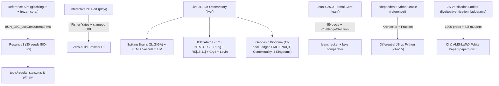

# Architecture (`docs/architecture.md`)

`glitchling-jam` (`v2.2.0`) combines four execution layers under one unified, five-tier verification discipline (`Build Standard A20`):

## Module Boundaries
1. **Frozen Core (`core/`):** Read-only copy of Creature #1 (`Asmodensius-v40/creatures/001/organism`). Never modified in this repository (`F18/D8`).
2. **Reference Subclass (`glitchling.ts`):** Adds four toggleable flaws (`scramble`, `leaky`, `backwards`, `misfire`) and repeatable CSV/JSON output (`results/summary.csv`, `results/results.json`).
3. **2D Browser Port (`play/`):** Self-contained HTML/JS/CSS educational explorer with Fisher–Yates world generation (`F03`) and clamped URL parameters (`F15`).
4. **3D Bio-Observatory (`live/`):** Modular zero-build ES modules (`live/js/sim/*.js`, `live/js/tsotchke/*.js`) rendered via vendored Three.js r170 and p5.js v1.11.3, verified by `live/test/{verification_ladder,lesion_experiments,dome_heptarch_probe,dome_ui_check}.mjs`.
5. **Formal & Oracle Verification (`lean/`, `reference/`, `scripts/`, `tests/`):** Pure Lean `v4.35.0` proofs (zero Mathlib), exact `Fraction`/Kronecker Python oracle, and cross-platform CI.
6. **Publication Pipeline (`paper/`, `dist/`):** Vector matplotlib figures (`scripts/generate_figures.py`), zero-warning AMS-LaTeX manuscript (`paper/main.tex`), frozen PDF, and standalone-verified arXiv tarball (`scripts/package_dist.py`).
